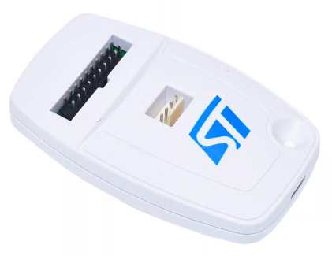
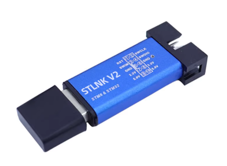

# XRDAP-F103C8

[中文](README.md)

XRDAP-F103C8 is CMSIS-DAP v2 debug probe firmware for STLINK V2 style STM32F103 boards, built on [libxr](https://github.com/xrobot-org/libxr) and part of the XR-DAP family. Keil, pyOCD, probe-rs and OpenOCD use it as an ordinary CMSIS-DAP probe. The firmware also implements the XR vendor extension, with which the host tool of [XRDAP-Host](https://github.com/Jiu-xiao/XRDAP-Host) reads and writes variables and has the probe sample them at a fixed period. The code shared by the XR-DAP probes is in [XRDAP-Core](https://github.com/Jiu-xiao/XRDAP-Core).

## Boards

### STLINK V2 standard board



### STLINK V2 aluminium-case board



The probe MCU is an STM32F103C8 or a pin-compatible F103 part (for example the APM32F103C8) with at least 64 KB of flash and 20 KB of RAM.

| Pin | Use |
|---|---|
| PB13 | SWCLK |
| PB14 | SWDIO |
| PB6 | Target reset (nRESET), open-drain output, released by default and pulled low when the debug tool asks for a reset |
| PA9 | Status light, red and blue, red when high, blue when low |
| PA11, PA12 | USB D-, D+ |

Where the STLINK V2 standard board has no pull-up on SWDIO, the target board pulls it up, or an external pull-up goes between SWDIO and 3.3V. The status light is described in [docs/boards.en.md](docs/boards.en.md).

## Flashing and updates

Every release has the files below:

| File | Contents | Chips |
|---|---|---|
| `xrdap-f103c8-72m.bin`, `xrdap-f103c8-72m.hex` | Firmware with a 72 MHz system clock | STM32F103C8, APM32F103C8 |
| `xrdap-f103c8-96m.bin`, `xrdap-f103c8-96m.hex` | Firmware with a 96 MHz system clock | APM32F103C8 and other compatible parts that run at 96 MHz |
| `xrdap-f103cb-72m.bin`, `xrdap-f103cb-72m.hex` | Firmware with a 72 MHz system clock, built for 128 KB of flash | Chips with 128 KB of flash, such as the STM32F103CB |
| `xrdap-f103cb-96m.bin`, `xrdap-f103cb-96m.hex` | Firmware with a 96 MHz system clock, built for 128 KB of flash | Compatible parts with 128 KB of flash that run at 96 MHz |
| `SHA256SUMS` | Checksums of these eight files | |

The `.bin` and `.hex` of one clock hold the same firmware; the flashing tool decides which one to use. The two clocks are compared in [docs/boards.en.md](docs/boards.en.md). With the downloaded files and `SHA256SUMS` in one directory, `sha256sum -c --ignore-missing SHA256SUMS` prints `OK` for each downloaded file that matches the release.

The C++ code of `xrdap-f103cb-*` is compiled for speed, so it handles DAP commands faster and OpenOCD and `xrdap` read and write faster than with `xrdap-f103c8-*`. These images fit only chips whose flash size register (`0x1FFFF7E0`, in KB) reads 128 KB, such as the STM32F103CB and C8 chips that read 128 KB; other chips use `xrdap-f103c8-*`. The register is read with `mem16 0x1FFFF7E0 1` in J-Link or `mdh 0x1FFFF7E0` in OpenOCD: `0080` is 128 KB, `0040` is 64 KB. Tools that take the flash size from the chip name, such as J-Link, flash `xrdap-f103cb-*` with the chip set to STM32F103CB; set to STM32F103C8 they may refuse to write above 64 KB. The two flash sizes are compared in [docs/boards.en.md](docs/boards.en.md).

The first flashing and every update go through another SWD debug probe: it is wired to the SWD port of the board's own MCU (the SWCLK, SWDIO, GND and 3.3V pads) and writes the firmware to `0x08000000`. For example with a J-Link and OpenOCD:

```
openocd -f interface/jlink.cfg -c "transport select swd" -f target/stm32f1x.cfg -c "program xrdap-f103c8-72m.bin 0x08000000 verify reset exit"
```

On the computer the probe is the USB device `1D50:6199` with the product name `XR-DAP-F103 CMSIS-DAP` and the serial `XRobot-XRDAP-` followed by the chip UID in upper-case hex, the same serial that DAP_Info reports. On Linux this udev rule gives ordinary users access to the probe:

```
SUBSYSTEM=="usb", ATTR{idVendor}=="1d50", ATTR{idProduct}=="6199", MODE="0666"
```

## Usage

Debug tools use the probe as a CMSIS-DAP v2 probe and, with several probes connected, select it by its serial, for example OpenOCD:

```
openocd -f interface/cmsis-dap.cfg -c "adapter serial XRobot-XRDAP-<UID>" -f target/<target>.cfg
```

On Windows, probe-rs 0.32.0 and earlier read interface names only on composite USB devices and do not list this single-interface probe; the fix is [probe-rs#4500](https://github.com/probe-rs/probe-rs/pull/4500), and releases after 0.32.0 work.

## Reading and sampling variables

With the XR vendor extension one command reads or writes several addresses and follows pointer chains, and the probe samples variables at a fixed period that does not depend on the USB round trip. `read`, `write` and `watch` of the host tool `xrdap` use these commands and need [XRDAP-Host](https://github.com/Jiu-xiao/XRDAP-Host) 0.6.0 or later (protocol version 2 of the vendor extension):

```
xrdap read --elf app.elf motor.speed motor.state
xrdap write --elf app.elf motor.mode=2
xrdap watch --elf app.elf motor.speed motor.current --period 1ms --csv log.csv
```

This firmware runs these commands over USB, with a 4096-byte sampling buffer and at most 32 items per frame. Sampling stops when `xrdap watch` ends; a USB bus reset (the probe unplugged, or the computer resetting the device) ends the connection on USB and its sampling. The command formats are in section 3 of XRDAP-Core's [`docs/protocol.en.md`](https://github.com/Jiu-xiao/XRDAP-Core/blob/main/docs/protocol.en.md).

## Performance

The table shows measurements of the four images: `xrdap-f103c8-*` from 0.6.0, `xrdap-f103cb-*` from 0.6.1. The host runs Windows 11, the target is an STM32H723, and the test program is XRDAP-Core's [`tests/`](https://github.com/Jiu-xiao/XRDAP-Core/tree/main/tests) (bce599e). All four images read and write correctly with an SWD request of 30 MHz, and every item is measured at that request. Small variable read / write is the median round trip of reading and writing one 4-byte SRAM variable with the vendor extension commands; block transfers write and read 16 KiB of SRAM, and the pipelined read keeps 4 requests in flight; the OpenOCD column is the time OpenOCD 0.12.0 takes to write and read 128 KiB of target SRAM (`0x24000000`); the sampling period is the shortest at which `xrdap watch` samples 8 SRAM variables for 60 s without skipped ticks or lost frames.

| Image | Small variable read / write | Block write / read / pipelined read | OpenOCD write / read, 128 KiB | Shortest period, 8 variables |
|---|---|---|---|---|
| `xrdap-f103c8-72m` | 309 / 335 µs | 150 / 171 / 212 KiB/s | 0.62 / 0.62 s | 600 µs |
| `xrdap-f103c8-96m` | 252 / 269 µs | 179 / 215 / 275 KiB/s | not measured / 0.47 s | 500 µs |
| `xrdap-f103cb-72m` | 262 / 259 µs | 178 / 199 / 271 KiB/s | 0.48 / 0.47 s | not measured |
| `xrdap-f103cb-96m` | 256 / 264 µs | 200 / 235 / 333 KiB/s | 0.36 / 0.36 s | not measured |

## Building

Building needs CMake 3.22 or newer, Ninja and the [Arm GNU Toolchain](https://developer.arm.com/downloads/-/arm-gnu-toolchain-downloads) 14.2 (`arm-none-eabi-gcc` on `PATH`). The `Release` preset in `CMakePresets.json` builds the 72 MHz and the 96 MHz firmware:

```
git clone --recursive https://github.com/Jiu-xiao/XRDAP-F103C8.git
cd XRDAP-F103C8
cmake --preset Release
cmake --build --preset Release
```

The firmware is `build/Release/XRDAP_F103C8_clock_72m/XRDAP-F103C8.elf` and `build/Release/XRDAP_F103C8_clock_96m/XRDAP-F103C8.elf`. The CMake option `XR_FLASH_SIZE_KB` is the flash size, 64 by default; 128 builds the firmware of the `xrdap-f103cb-*` images, with C code still at `-Os`, C++ code at `-O3` and a 128 KB FLASH length in the linker script:

```
cmake --preset Release -B build/Release-128k -DXR_FLASH_SIZE_KB=128
cmake --build build/Release-128k
```

CI builds both flash sizes in the `ghcr.io/xrobot-org/docker-image-stm32` container, makes the `.bin` and `.hex` with objcopy, and creates a draft release when a `v*` tag is pushed.

The colour conversion of the status light has tests on the computer, built with the system's GCC:

```
cmake -S test -B build-test
cmake --build build-test
ctest --test-dir build-test
```

The version is the `VERSION` of `project()` in `CMakeLists.txt`; the build appends the commit, for example `0.6.0+g1a2b3c4`, and DAP_Info reports it.

## Directories

| Path | Contents |
|---|---|
| `User/app_main.cpp` | USB device, DAP instance and main loop |
| `User/tick_timer.*` | Sampling tick timer (TIM2) |
| `User/status_led.*`, `User/led_drive.hpp` | Status light (PA9, PWM of TIM1) and its colour conversion |
| `User/probe_info.hpp`, `User/chip_uid.hpp` | Probe identity: product name, firmware version, the chip UID used in the serial |
| `User/f1_gpio.hpp` | Register-level GPIO for SWD |
| `User/xrdap_port.hpp` | Platform part of XRDAP-Core: the size of the sampling buffer |
| `Core/`, `Drivers/` | STM32CubeMX-generated initialization code (including the two clock settings) and HAL |
| `cmake/` | Toolchain file, CubeMX-generated CMake files, libxr integration |
| `Middlewares/Third_Party/XRDAP-Core` | XRDAP-Core submodule |
| `Middlewares/Third_Party/LibXR` | libxr submodule |
| `test/` | Tests on the computer |
| `docs/` | Clocks, flash size and status light |
