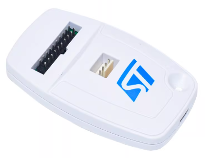
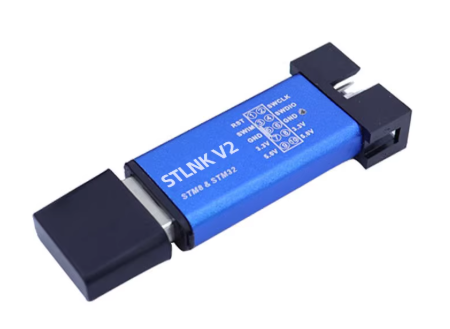

# XRDAP-F103C8

[English](README.en.md)

XRDAP-F103C8 是运行在 STLINK V2 形态的 STM32F103 板子上的 CMSIS-DAP v2 调试探针固件，基于 [libxr](https://github.com/xrobot-org/libxr)，属于 XR-DAP 系列。Keil、pyOCD、probe-rs、OpenOCD 把它当作普通的 CMSIS-DAP 探针使用。固件还实现了 XR 厂商扩展，配合电脑端工具 [XRDAP-Host](https://github.com/Jiu-xiao/XRDAP-Host) 读写变量、在探针上按固定周期采样变量。XR-DAP 各探针共用的代码在 [XRDAP-Core](https://github.com/Jiu-xiao/XRDAP-Core)。

## 板子

### STLINK V2 标准版



### STLINK V2 淘宝铝壳版



探针的 MCU 为 STM32F103C8 或引脚兼容的 F103 型号（例如 APM32F103C8），Flash 不少于 64 KB，RAM 不少于 20 KB。

| 引脚 | 用途 |
|---|---|
| PB13 | SWCLK |
| PB14 | SWDIO |
| PB6 | 目标复位（nRESET），开漏输出，平时释放，调试工具要求复位时拉低 |
| PA9 | 状态灯，红蓝双色，高电平亮红，低电平亮蓝 |
| PA11、PA12 | USB D-、D+ |

STLINK V2 标准版的 SWDIO 上没有上拉电阻时，由目标板上拉，或在 SWDIO 与 3.3V 之间外加上拉电阻。状态灯的显示方式见 [docs/boards.md](docs/boards.md)。

## 烧录和升级

每个发布版本提供以下文件：

| 文件 | 内容 | 适用芯片 |
|---|---|---|
| `xrdap-f103c8-72m.bin`、`xrdap-f103c8-72m.hex` | 系统时钟 72 MHz 的固件 | STM32F103C8、APM32F103C8 |
| `xrdap-f103c8-96m.bin`、`xrdap-f103c8-96m.hex` | 系统时钟 96 MHz 的固件 | APM32F103C8 等可运行在 96 MHz 的兼容型号 |
| `xrdap-f103cb-72m.bin`、`xrdap-f103cb-72m.hex` | 系统时钟 72 MHz、按 128 KB Flash 编译的固件 | Flash 为 128 KB 的芯片，例如 STM32F103CB |
| `xrdap-f103cb-96m.bin`、`xrdap-f103cb-96m.hex` | 系统时钟 96 MHz、按 128 KB Flash 编译的固件 | Flash 为 128 KB、可运行在 96 MHz 的兼容型号 |
| `SHA256SUMS` | 以上八个文件的校验和 | |

同一时钟的 `.bin` 和 `.hex` 内容相同，按烧录工具选用其一；两种时钟的区别见 [docs/boards.md](docs/boards.md)。把下载的文件和 `SHA256SUMS` 放在同一目录，运行 `sha256sum -c --ignore-missing SHA256SUMS`，每个已下载的文件显示 `OK` 即与发布一致。

`xrdap-f103cb-*` 的 C++ 代码按速度优化编译，处理 DAP 命令更快，OpenOCD 和 `xrdap` 的读写速度高于 `xrdap-f103c8-*`，但只适用于 Flash 大小寄存器（`0x1FFFF7E0`，单位 KB）读出 128 KB 的芯片，例如 STM32F103CB，以及读出 128 KB 的 C8 芯片；其他芯片使用 `xrdap-f103c8-*`。这个寄存器可以用 J-Link 的 `mem16 0x1FFFF7E0 1` 或 OpenOCD 的 `mdh 0x1FFFF7E0` 读取，`0080` 为 128 KB，`0040` 为 64 KB。用 J-Link 等按芯片型号确定 Flash 大小的工具烧录 `xrdap-f103cb-*` 时，芯片型号设为 STM32F103CB，型号设为 STM32F103C8 的工具可能拒绝写入 64 KB 以上的地址。两种 Flash 大小的比较见 [docs/boards.md](docs/boards.md)。

第一次烧录和每次升级都由另一个 SWD 调试器完成：调试器接板上 MCU 自己的 SWD 调试口（SWCLK、SWDIO、GND、3.3V 四个焊盘），把固件写到 `0x08000000`。以 J-Link 和 OpenOCD 为例：

```
openocd -f interface/jlink.cfg -c "transport select swd" -f target/stm32f1x.cfg -c "program xrdap-f103c8-72m.bin 0x08000000 verify reset exit"
```

探针在电脑上是 USB 设备 `1D50:6199`，产品名为 `XR-DAP-F103 CMSIS-DAP`，序列号为 `XRobot-XRDAP-` 加芯片 UID 的大写十六进制，与 DAP_Info 报告的序列号相同。Linux 上加入以下 udev 规则后，普通用户可以访问探针：

```
SUBSYSTEM=="usb", ATTR{idVendor}=="1d50", ATTR{idProduct}=="6199", MODE="0666"
```

## 使用

调试工具按 CMSIS-DAP v2 使用探针，接有多块探针时按序列号选择，例如 OpenOCD：

```
openocd -f interface/cmsis-dap.cfg -c "adapter serial XRobot-XRDAP-<UID>" -f target/<目标>.cfg
```

Windows 上，probe-rs 0.32.0 及更早的版本只在复合 USB 设备上读取接口名，列不出这个只有一个接口的探针；修复见 [probe-rs#4500](https://github.com/probe-rs/probe-rs/pull/4500)，0.32.0 之后的版本可以使用。

## 变量读写与采样

XR 厂商扩展让一条命令读写多个地址、沿指针链解引用，并由探针按固定周期采样变量，周期不受 USB 往返延迟的影响。电脑端工具 `xrdap` 的 `read`、`write` 和 `watch` 使用这些命令，需要 [XRDAP-Host](https://github.com/Jiu-xiao/XRDAP-Host) 0.6.0 或更新的版本（厂商扩展的协议版本 2）：

```
xrdap read --elf app.elf motor.speed motor.state
xrdap write --elf app.elf motor.mode=2
xrdap watch --elf app.elf motor.speed motor.current --period 1ms --csv log.csv
```

本固件经 USB 执行这些命令，采样缓冲为 4096 字节，一帧最多 32 个条目。`xrdap watch` 结束时停止采样；USB 总线复位（拔出探针或电脑复位设备）时，USB 上的连接和采样随之结束。命令格式见 XRDAP-Core 的 [`docs/protocol.md`](https://github.com/Jiu-xiao/XRDAP-Core/blob/main/docs/protocol.md) 第 3 节。

## 性能

下表为四种固件的测量结果：`xrdap-f103c8-*` 为 0.6.0，`xrdap-f103cb-*` 为 0.6.1。主机为 Windows 11，目标为 STM32H723，测试程序为 XRDAP-Core 的 [`tests/`](https://github.com/Jiu-xiao/XRDAP-Core/tree/main/tests)（bce599e）。四种固件在 SWD 请求 30 MHz 时读写全部正确，各项在这一请求下测量。小变量读写是用厂商扩展命令读、写一个 4 字节 SRAM 变量的往返时间中位数；块读写在 SRAM 中写入、读出 16 KiB，流水读同时有 4 个请求在途；OpenOCD 一列是 OpenOCD 0.12.0 向目标 SRAM（`0x24000000`）写入、读出 128 KiB 的用时；采样周期是 `xrdap watch` 采样 8 个 SRAM 变量、连续 60 s 不跳拍不丢帧的最短周期。

| 固件 | 小变量读 / 写 | 块写 / 读 / 流水读 | OpenOCD 写 / 读 128 KiB | 8 个变量采样最短周期 |
|---|---|---|---|---|
| `xrdap-f103c8-72m` | 309 µs / 未测 | 150 / 171 / 212 KiB/s | 0.62 / 0.62 s | 600 µs |
| `xrdap-f103c8-96m` | 252 / 269 µs | 179 / 215 / 275 KiB/s | 未测 / 0.47 s | 500 µs |
| `xrdap-f103cb-72m` | 262 µs / 未测 | 178 / 199 / 271 KiB/s | 0.48 / 0.47 s | 未测 |
| `xrdap-f103cb-96m` | 256 µs / 未测 | 200 / 235 / 333 KiB/s | 0.36 / 0.36 s | 未测 |

## 编译

编译需要 CMake 3.22 以上、Ninja 和 [Arm GNU Toolchain](https://developer.arm.com/downloads/-/arm-gnu-toolchain-downloads) 14.2（`arm-none-eabi-gcc` 在 `PATH` 中）。`CMakePresets.json` 中的 `Release` preset 编出 72 MHz 和 96 MHz 两种固件：

```
git clone --recursive https://github.com/Jiu-xiao/XRDAP-F103C8.git
cd XRDAP-F103C8
cmake --preset Release
cmake --build --preset Release
```

固件在 `build/Release/XRDAP_F103C8_clock_72m/XRDAP-F103C8.elf` 和 `build/Release/XRDAP_F103C8_clock_96m/XRDAP-F103C8.elf`。CMake 选项 `XR_FLASH_SIZE_KB` 为 Flash 大小，默认 64；设为 128 时编出 `xrdap-f103cb-*` 对应的固件，C 代码仍为 `-Os`，C++ 代码为 `-O3`，链接脚本的 FLASH 长度为 128 KB：

```
cmake --preset Release -B build/Release-128k -DXR_FLASH_SIZE_KB=128
cmake --build build/Release-128k
```

CI 在 `ghcr.io/xrobot-org/docker-image-stm32` 容器中编译两种 Flash 大小，用 objcopy 生成 `.bin` 和 `.hex`，推送 `v*` 标签时生成发布草稿。

状态灯的灯色换算有电脑上的测试，用系统的 GCC 编译：

```
cmake -S test -B build-test
cmake --build build-test
ctest --test-dir build-test
```

版本号是 `CMakeLists.txt` 中 `project()` 的 `VERSION`，编译时附加提交号，例如 `0.6.0+g1a2b3c4`，DAP_Info 报告这个版本。

## 目录

| 路径 | 内容 |
|---|---|
| `User/app_main.cpp` | USB 设备、DAP 实例和主循环 |
| `User/tick_timer.*` | 采样节拍定时器（TIM2） |
| `User/status_led.*`、`User/led_drive.hpp` | 状态灯（PA9、TIM1 的 PWM）和灯色换算 |
| `User/probe_info.hpp`、`User/chip_uid.hpp` | 探针身份：产品名、固件版本、序列号中的芯片 UID |
| `User/f1_gpio.hpp` | SWD 用的寄存器级 GPIO |
| `User/xrdap_port.hpp` | XRDAP-Core 的平台部分：采样缓冲的大小 |
| `Core/`、`Drivers/` | STM32CubeMX 生成的初始化代码（包括两种时钟的设置）和 HAL |
| `cmake/` | 工具链文件、CubeMX 生成的 CMake 文件、libxr 的接入 |
| `Middlewares/Third_Party/XRDAP-Core` | XRDAP-Core 子模块 |
| `Middlewares/Third_Party/LibXR` | libxr 子模块 |
| `test/` | 电脑上的测试 |
| `docs/` | 时钟、Flash 大小和状态灯的说明 |
