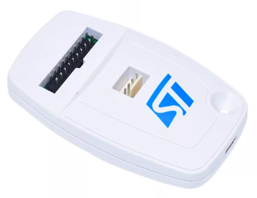
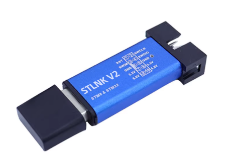

# XRDAP-F103C8

[English](README.en.md)

跑在 STLINK V2 形态 STM32F103 板子上的 CMSIS-DAP v2 调试探针固件，基于 [libxr](https://github.com/xrobot-org/libxr)，属于 XR-DAP 系列（另见 [XRDAP-ESP](https://github.com/Jiu-xiao/XRDAP-ESP)）。Keil、pyOCD、probe-rs、OpenOCD 把它当作普通的 CMSIS-DAP 探针使用。固件还实现了 XR 厂商扩展：一条命令读写多个地址、沿指针链解引用、在探针上按固定周期采样目标变量，配合电脑端工具 [XRDAP-Host](https://github.com/Jiu-xiao/XRDAP-Host)（`xrdap`）查看和画曲线。

整个固件约 53 KB，64 KB Flash 的 STM32F103C8 即可容纳。

## 硬件

### STLINK V2 标准版


### STLINK V2 淘宝铝壳版


探针 MCU 为 `STM32F103C8` 或引脚兼容的 F103 型号（例如 `APM32F103C8`），Flash 不少于 64 KB。

| 引脚 | 功能 |
|---|---|
| `PB13` | SWCLK |
| `PB14` | SWDIO |
| `PB6` | nRESET |
| `PA9` | 指示灯（DAP 活动时变亮） |
| `PA11` / `PA12` | USB D- / D+ |

STLINK V2 标准版的 SWDIO 上通常没有上拉电阻，需要目标板上拉，或在 SWDIO 与 3.3V 之间外加上拉电阻。

## 烧录固件

Release 中有两个镜像，区别只在系统时钟：

| 镜像 | 系统时钟 | 适用 |
|---|---|---|
| `XRDAP-F103C8-72m.bin` | 72 MHz | STM32F103C8 |
| `XRDAP-F103C8-96m.bin` | 96 MHz | APM32F103C8 等可超频的兼容型号 |

固件从 `0x08000000` 开始，通过板子上的 SWD 调试口（SWCLK、SWDIO、GND、3.3V 四个焊盘）用另一个调试器烧录，例如 J-Link：

```
openocd -f interface/jlink.cfg -c "transport select swd" -f target/stm32f1x.cfg -c "program XRDAP-F103C8-72m.bin 0x08000000 verify reset exit"
```

烧录后插上 USB，探针以 `1D50:6199` 枚举，产品名 `XR-DAP-F103 CMSIS-DAP`，序列号为 `XRobot-XRDAP-` 加芯片 UID 的大写十六进制，与 DAP_Info 中的序列号相同。Linux 下普通用户访问需要 udev 规则：

```
SUBSYSTEM=="usb", ATTR{idVendor}=="1d50", ATTR{idProduct}=="6199", MODE="0666"
```

## 使用

调试工具按 CMSIS-DAP v2 使用即可，例如 OpenOCD：

```
openocd -f interface/cmsis-dap.cfg -c "adapter serial XRobot-XRDAP-21001200142D363637365744" -f target/stm32f3x.cfg
```

`xrdap list` 列出探针：

```
$ xrdap list
XRobot-XRDAP-21001200142D363637365744  XR-DAP-F103 CMSIS-DAP
    USB XRobot-XRDAP-21001200142D363637365744    --probe usb:XRobot-XRDAP-21001200142D363637365744
```

`xrdap info` 显示 DAP_Info 和厂商扩展的能力（下面是没有接目标时的输出）：

```
$ xrdap info -p 21001200142D363637365744
连接：USB XRobot-XRDAP-21001200142D363637365744
探针：XRobot XR-DAP-F103，序列号 XRobot-XRDAP-21001200142D363637365744，固件 0.6.0
CMSIS-DAP：2.0.0，包长 512 字节，最多 4 个包在途
厂商扩展：版本 1，功能 READ、WRITE、采样、8 字节访问（0x0F）
  每次最多 32 个条目，最多 8 级指针，采样缓冲 4096 字节
  探针时间 128.435740 s，单次 SWD 访问耗时还没有标定（每次 SUB_SET 时按当前时钟标定）
目标：连接失败（读 DPIDR 失败：SWD 应答 没有应答（检查接线、目标供电）（响应 05 00 07））
```

读写变量、采样（`xrdap read`、`write`、`watch`）的用法见 XRDAP-Host 的说明。

## 厂商扩展

命令格式与 XRDAP-ESP 相同，见 [XRDAP-ESP 协议文档](https://github.com/Jiu-xiao/XRDAP-ESP/blob/main/docs/protocol.md) 第 3 节的 0x80 到 0x85。本固件与 ESP 版的差别：

- 只有 USB 一种传输，采样在 USB 总线复位或拔出后停止，没有 0x86 Wi-Fi 命令；
- 采样缓冲为 4096 字节（20 KB RAM 的限制），一帧最多 32 个条目；
- 采样由主循环执行：每读完一拍，主循环先处理一条待执行的 DAP 命令，再检查下一拍是否到期；SUB_SET 报告的单帧耗时为试读耗时乘 1.6。

## 构建

使用 GCC（[Arm GNU Toolchain](https://developer.arm.com/downloads/-/arm-gnu-toolchain-downloads) 14.2）、CMake 和 Ninja：

```
git clone --recursive https://github.com/Jiu-xiao/XRDAP-F103C8.git
cd XRDAP-F103C8
cmake --preset Release
cmake --build build/Release
```

`build/Release/XRDAP_F103C8_clock_72m/` 和 `build/Release/XRDAP_F103C8_clock_96m/` 下各生成一个 `XRDAP-F103C8.elf`。

| 目录 | 内容 |
|---|---|
| `User/app_main.cpp` | USB 设备、DAP 实例和主循环 |
| `User/fast_gpio.hpp` | SWD 位翻转用的寄存器级 GPIO |
| `User/probe_info.*` | 探针身份（DAP_Info、USB 序列号） |
| `User/vendor/` | XR 厂商扩展：命令处理、MEM-AP 访问、采样、帧缓冲 |
| `Core/`、`Drivers/` | STM32CubeMX 生成的初始化代码和 HAL |
| `Middlewares/Third_Party/LibXR` | libxr 子模块 |
